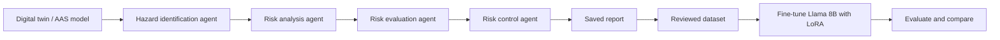

# Automating Safety and Risk Management with LLM Agents

Master's thesis, University of Stuttgart, Institute of Industrial Automation and Software Engineering (IAS), 2024. Grade: 1.3

Risk management for safety-critical products (for example medical devices or automation systems) is mostly manual, time-consuming and can miss important hazards. This project automates the risk management process with a pipeline of LLM agents that follows ISO standards (ISO 14971, ISO 31000, ISO 15026).

## What it does

- **Digital twin as input:** The system to analyse is described as an Asset Administration Shell (AAS) information model. Users can import, edit and delete it in the web app.
- **Agent pipeline along the ISO process:** Each step of the risk management process is handled by its own LLM agent, and every agent builds on the results of the previous one:
  1. Hazard identification
  2. Risk analysis (failure modes, causes, effects)
  3. Risk evaluation
  4. Risk control (recommended actions)
- **Human in the loop:** Engineers can review and adjust every intermediate result before the next agent continues.
- **Dataset generation:** All generated steps are saved as prompt–response pairs and later used to fine-tune smaller models.



## Key results

- Benchmarked several LLMs (GPT-4, Llama, Qwen, Mistral) on the risk management task, rated by GPT-4 and by human evaluation.
- Found that the public GPQA benchmark is a strong predictor of risk analysis performance, which makes model selection cheaper.
- Fine-tuned Llama 8B with LoRA on reviewed GPT-4 outputs (knowledge distillation). The small model improved clearly and can run locally.

## Tech stack

Python, Flask, SQLAlchemy, OpenAI API, Llama / Mistral / Qwen, LoRA fine-tuning, Asset Administration Shell (AAS)

## Structure

- `WebApp/` – Flask web app with the agent pipeline (`agents.py`, `llm.py`)
- `AssetAdministrationShellV2/` – AAS information model (Flask, SQLAlchemy)
- `FMEA Collection Data/` – reference FMEA tables used during development

## Run

```bash
cd WebApp
pip install flask flask-cors flask-caching openai python-dotenv
cp ../.env.example .env   # then add your own OPENAI_API_KEY
python app.py
```

## Future work

- Test and fine-tune more open models
- Have safety engineers review the dataset and expand it
- Try newer fine-tuning methods
