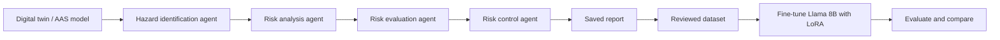

# Automating Safety and Risk Management with LLM Agents

Master's thesis, University of Stuttgart, Institute of Industrial Automation and Software Engineering (IAS), 2024. Grade: 1.3

Risk management for safety-critical products (for example medical devices or automation systems) is mostly manual, time-consuming and can miss important hazards. This project automates the risk management process with a pipeline of LLM agents that follows ISO standards (ISO 14971, ISO 31000, ISO 15026).

## What it does

- **Digital twin as input:** The system to analyse is described as an Asset Administration Shell (AAS) information model. Users can import, edit and delete it in the web app.
- **Agent pipeline along the ISO process:** Each step of the risk management process is handled by its own LLM agent, and every agent builds on the results of the previous one:
  1. Hazard identification
  2. Risk analysis (failure modes, causes, effects)
  3. Risk evaluation
  4. Risk control (recommended actions)
- **Human in the loop:** Engineers can review and adjust every intermediate result before the next agent continues.
- **Dataset generation:** All generated steps are saved as prompt–response pairs and later used to fine-tune smaller models.



## Results

### Model benchmark on the risk management task

Accuracy relative to GPT-4, rated by GPT-4 and by human evaluation:

| Model | GPT-4 evaluation | Human evaluation |
|---|---|---|
| GPT-4 | 100.0% | 100.0% |
| Llama-3.1-70B-Instruct | 85.0% | 87.0% |
| Qwen2-72B-Instruct | 83.8% | 82.2% |
| Mistral-7B-Instruct | 82.0% | 80.0% |
| Llama 8B Instruct | 76.4% | 72.0% |

### Which public benchmarks predict risk analysis performance?

Testing models directly on risk analysis costs time and money. I therefore correlated the results with general benchmarks:

| Pair | Pearson r | p-value |
|---|---|---|
| Human eval vs. GPQA | 0.948 | 0.014 |
| GPT-4 eval vs. GPQA | 0.900 | 0.037 |
| Human eval vs. MMLU | 0.802 | 0.102 |
| GPT-4 eval vs. MMLU | 0.745 | 0.149 |
| Human eval vs. GPT-4 eval | 0.982 | 0.003 |

GPQA (scientific reasoning) is a strong and significant predictor, so it is a good first filter when choosing a model for risk analysis. The high agreement between human and GPT-4 ratings also shows that GPT-4 works well as an automatic evaluator for this task.

### Fine-tuning a small model

GPT-4 outputs that had been reviewed were used as training data (knowledge distillation) to fine-tune Llama 8B with LoRA (instruction fine-tuning):

| Metric | Before | After | Change |
|---|---|---|---|
| GPT-4 evaluation | 76.4% | 81.0% | +4.6 pp |
| Human evaluation | 72.0% | 77.0% | +5.0 pp |

The fine-tuned 8B model narrows the gap to much larger models, while staying cheap and fast enough to run locally.

## Tech stack

Python, Flask, SQLAlchemy, OpenAI API, Llama / Mistral / Qwen, LoRA fine-tuning, Asset Administration Shell (AAS)

## Structure

- `WebApp/` – Flask web app with the agent pipeline (`agents.py`, `llm.py`)
- `AssetAdministrationShellV2/` – AAS information model (Flask, SQLAlchemy)
- `FMEA Collection Data/` – reference FMEA tables used during development

## Run

```bash
cd WebApp
pip install flask flask-cors flask-caching openai python-dotenv
cp ../.env.example .env   # then add your own OPENAI_API_KEY
python app.py
```

## Future work

- Test and fine-tune more open models
- Have safety engineers review the dataset and expand it
- Try newer fine-tuning methods
